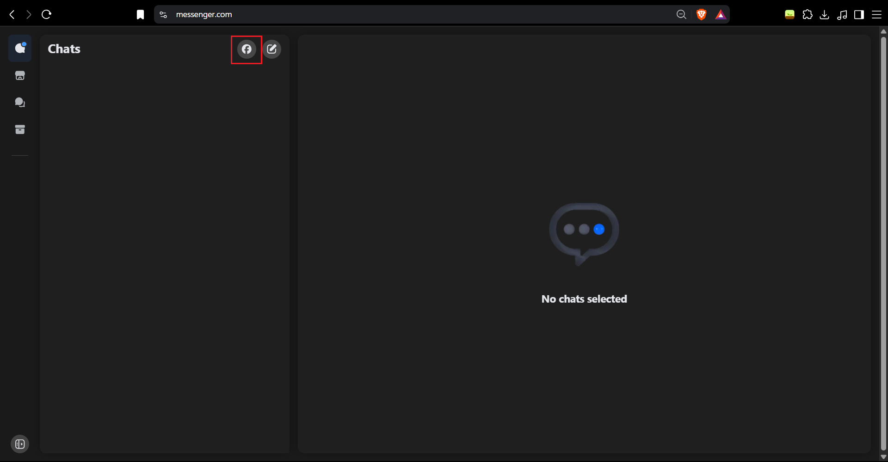
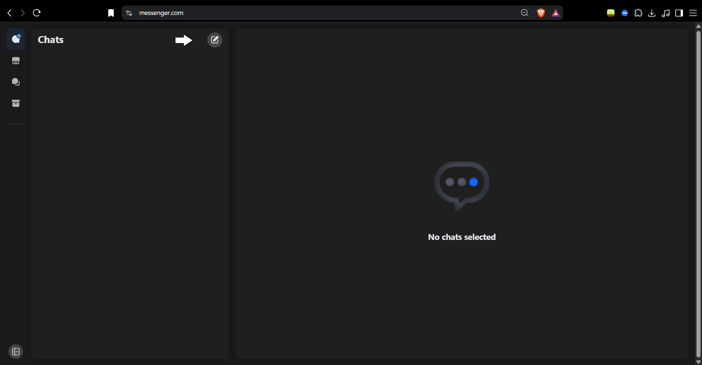

# Unbook

A minimal, set-and-forget browser extension that removes the distracting Facebook button from [messenger.com](https://www.messenger.com).

Works on **Brave**, **Google Chrome**, **Microsoft Edge**, **Vivaldi**, **Opera**, **Arc**, and other Chromium-based browsers (Chromium 105+).

## Before & After

| Before | After |
| :---: | :---: |
|  |  |

## Features

- **Zero flicker:** Injects CSS at `document_start` so the button is hidden before it paints.
- **SPA-resilient:** Uses a lightweight `MutationObserver` to handle React re-renders cleanly without breaking Messenger's DOM.
- **Chat-safe:** Explicitly ignores chat message content (`[role="main"]`, `[role="grid"]`, `[role="log"]`), so Facebook links sent in conversations stay intact.
- **Minimal & private:** No popups, no background service workers, no tracking, and no network requests. Only runs on `messenger.com`.

## Installation (Unpacked)

1. Download or clone this repository.
2. Open your browser's extensions page:
   - **Brave:** `brave://extensions`
   - **Chrome:** `chrome://extensions`
   - **Edge:** `edge://extensions`
3. Enable **Developer mode** (toggle in the top-right corner).
4. Click **Load unpacked** and select this folder.
5. Reload `messenger.com`.

## Packaging for Chrome Web Store / Edge Add-ons

Run the included PowerShell script to generate a clean `.zip` containing only the extension files (`manifest.json`, `styles.css`, `content.js`, and `icons/`):

```powershell
.\build.ps1
```

The package will be written to `dist/unbook-v1.0.0.zip`.

## Privacy

Unbook collects **no user data** of any kind. See [PRIVACY.md](PRIVACY.md) for details.

## Disclaimer

Unbook is an independent, open-source project and is not affiliated with, endorsed by, or connected to Meta Platforms, Inc., Facebook, or Messenger.

## License

MIT — see [LICENSE](LICENSE).
